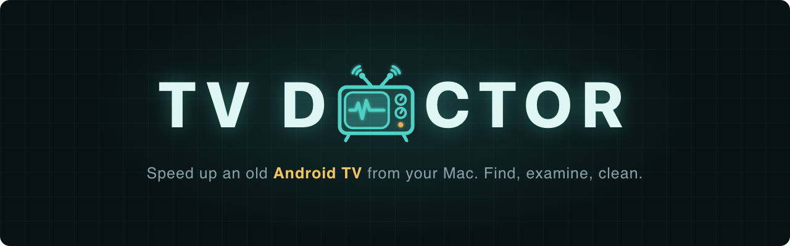

# TV Doctor

A Rust tool and macOS app that speeds up an old Android TV over your home network.

## What is TV Doctor?

TV Doctor finds your Android TV on the network and does the things that make it
fast again, from a window on your Mac or from the terminal:

- **Health report** - storage, free memory, running apps, installed apps
- **Clean** - drops app caches and stops background apps, without touching logins
- **Optimise** - recompiles installed apps and switches off menu animations
- **Bloat** - switches off preinstalled apps you never use, with full undo
- **Launch and stop apps** - YouTube, Netflix and Spotify, with no ADB needed
- **Remote control** - use your Mac as the TV's remote, with no ADB needed
- **TV Nurse** - a companion app on the TV, for storage, memory and per-app details without ADB

```
┌─────────────────────────────────────────────┐
│                 TV DOCTOR                   │
├─────────────────────────────────────────────┤
│  ✅ Finds the TV on your network            │
│  ✅ Window on your Mac, or the command line │
│  ✅ DStv, YouTube, Netflix, Spotify safe    │
│  ✅ Every change journaled and undoable     │
│  ✅ No external crates, builds offline      │
└─────────────────────────────────────────────┘
```

## Requirements

### Hardware
- An Android TV
- A Mac on the same network as the TV

### Software (on your Mac)
- [Rust](https://rustup.rs/)
- [Android platform tools](https://developer.android.com/tools/releases/platform-tools) (`adb`)

```bash
# Install on macOS
curl --proto '=https' --tlsv1.2 -sSf https://sh.rustup.rs | sh
brew install --cask android-platform-tools
```

## Quick Start

```bash
# 1. Clone this repo
git clone https://github.com/Sbonelo-Mntungwa/tv-doctor.git
cd tv-doctor

# 2. Build the tool and the app
./scripts/build.sh

# 3. Open it
open -a TVDoctor
```

`scripts/build.sh` installs the app as `TVDoctor.app` in your own
`~/Applications` folder, so after the first build you can also open it from
Spotlight or Launchpad by typing **TV Doctor**, or keep it in your Dock.

The window opens in your browser at `http://127.0.0.1:8787`. Nothing leaves your
Mac. Press **Find my TV**, pick your TV from the list, and TV Doctor connects
to it and opens the controls. Next time it offers your TV straight away.

The first time, macOS asks whether TV Doctor may find devices on your local
network. Choose **Allow**.

## Your TV

TV Doctor searches your network for the TV and remembers its address in
`~/.config/tvdoctor/config.json`, outside the project, so there is nothing to
set up. No Wi-Fi details are needed: your Mac only has to be on the same
network as the TV.

If it picks the wrong TV or searches the wrong network, tell it directly:

```bash
./target/release/tvdoctor --ip 192.168.1.20 connect   # a specific TV, remembered from then on
./target/release/tvdoctor discover --subnet 192.168.1 # search a specific network
```

To protect extra apps from `bloat`, add them to the config file:

```json
{ "ip": "192.168.1.20", "keep": ["com.showmax.app"] }
```

### Find Your TV's IP

```bash
# Option 1: Let TV Doctor search the network
./target/release/tvdoctor discover

# Option 2: On the TV
# Settings > Network & Internet > your network > IP address

# Option 3: Check your router's list of connected devices
```

## Switching On ADB (for clean, optimise and bloat)

Launching apps and the report over Cast work straight away. The cleanup
commands need ADB over the network:

1. On the TV, open **Settings > Device Preferences > About**
2. Select **Build** seven times until it says you are a developer
3. Go back to **Developer options** and switch on **Network debugging** (or **ADB debugging**)
4. Run `./target/release/tvdoctor connect`
5. On the TV, choose **Always allow from this computer**

Some TVs only allow USB debugging. If yours does, run
`./target/release/tvdoctor guide` for the same cleanup done step by step with
the remote.

## Remote Control (no ADB needed)

Some TVs never allow ADB. The remote works on those as well, because it uses
the same connection as the Google TV phone app.

1. In the app, press **Pair** on the Remote card, or run `tvdoctor remote pair`
2. Type in the code the TV shows

That's all. The Mac is remembered, so you only pair once. Use the arrows, OK,
Back, Home, Settings, volume, power and the number pad, or click the card and
use your keyboard: arrow keys, Enter, Backspace, H for Home, and digits.

```bash
tvdoctor remote status            # screen, volume and the app in front
tvdoctor remote press home        # one key
tvdoctor remote press settings down down ok
tvdoctor remote press 1969        # digits, one after another
tvdoctor remote press hold:back:15   # hold a key for 15 seconds
tvdoctor remote keys              # every key name
```

## TV Nurse (no ADB needed)

TV Nurse is a small companion app that runs on the TV and answers TV Doctor
over the home network. It is for TVs that never allow ADB. It can:

- report storage, memory, and every app's size, cache and last use
- free memory by closing apps running in the background
- open any app's settings page, so you can press Clear cache or Disable

With TV Nurse paired, the treatment commands and the Treatment card work on a
TV without ADB. Each one uses ADB when the TV allows it and TV Nurse when it
does not:

| Command | Through TV Nurse |
|---------|------------------|
| `report` | Storage, memory, animations, every app's size, cache and last use |
| `clean` | Closes background apps, then opens each big cache for you to clear |
| `optimize` | Opens Developer options for the animations and checks them. Recompiling needs ADB |
| `tune` | Animations, and the background process limit |
| `bloat` | Lists extras and unused apps; with `--yes`, opens each one for you to Disable |
| `restore` | Opens each app it switched off for you to Enable, and resets animations |
| `apps`, `update` | Versions and dates; `--open` shows each Play Store page |
| `full` | All of the above, in order |
| `reboot` | Holds the remote's power button; you choose Restart |

Where only a Settings button can make the change, TV Nurse opens the page,
you press the button with the remote, and TV Nurse checks that it took. In the
app window those steps show **Done**, **Skip** and **Stop** under the Monitor.
A raw `shell` and recompiling apps need ADB, so they are not available.

**Build it** (one-off setup is at the top of the script):

```bash
./scripts/build-helper.sh        # makes android/helper/build/tv-nurse.apk
```

**Put it on the TV.** Install the free **Downloader** app from the Play Store
on the TV, serve the APK from your Mac, and send the TV the link with the
remote (`tvdoctor remote link http://YOUR-MAC:PORT/tv-nurse.apk`). Downloader
opens it. If Play Protect blocks the install, switch off **Verify apps** under
**Settings > Device Preferences > Security & restrictions**, install, and switch
it back on.

**Set it up.** Open TV Nurse on the TV. It shows a six-digit code and two
permissions to allow: **Usage access** and **Energy optimisation**. Then:

```bash
tvdoctor nurse pair 482913       # the code on the TV Nurse screen
tvdoctor nurse report            # sizes, caches, apps nobody uses
tvdoctor nurse free              # close background apps
tvdoctor nurse clean             # clear the biggest caches, with you at the remote
tvdoctor nurse open com.example.app
```

**The code changes every hour.** When it does, the old one stops working and
TV Doctor asks for the new one: on the connecting screen, in the TV Nurse
card, or with `tvdoctor nurse pair`. After five wrong codes in a row TV Nurse
refuses every code for a minute, so the code cannot be guessed in its hour.

The current code is kept in `~/.config/tvdoctor/nurse-codes`, and the key the
app is signed with in `~/.config/tvdoctor/helper-signing.jks`. Keep that key:
Android only installs an update signed with the same one.

## Using It

```bash
tvdoctor report           # what is wrong
tvdoctor clean            # free space, drop caches, stop background apps
tvdoctor optimize         # recompile apps, switch off animations (10-30 min)
tvdoctor bloat            # list unused preinstalled apps
tvdoctor reboot --yes     # restart so it all takes effect

tvdoctor launch youtube   # start an app, no ADB needed
tvdoctor restore --yes    # undo everything TV Doctor changed
tvdoctor --help           # every command
```

In the app window, type any of these into the command line under the Monitor,
without `tvdoctor` (for example `nurse free`), or type `help` for the list.
`shell` is terminal only. Run them in the terminal as `./target/release/tvdoctor`
from the project folder. Add
`--dry-run` to any command to see what it would do without changing anything.

## Project Structure

```
tv-doctor/
├── README.md               # This file
├── Cargo.toml
├── scripts/
│   └── build.sh            # Build, then install ~/Applications/TVDoctor.app
├── docs/
│   └── images/
│       └── banner.png      # The banner at the top of this file
├── android/helper/          # TV Nurse, the companion app for the TV
├── macos/
│   ├── Info.plist          # The app's details for macOS
│   ├── AppIcon.icns        # The app icon
│   └── launch              # What runs when you open the app
└── src/
    ├── main.rs             # Commands and arguments
    ├── server.rs           # The app window (local web server)
    ├── app.html            # The window's page
    ├── cmds.rs             # What each command does
    ├── adb.rs              # Talking to the TV over ADB
    ├── cast.rs             # Launching apps over Cast
    ├── remote.rs           # The Mac as the TV's remote control
    ├── proto.rs            # The small protobuf encoder both of them use
    ├── net.rs              # Finding the TV on the network
    ├── catalog.rs          # Protected apps and known bloat
    ├── config.rs           # Remembered TV and undo journal
    ├── menu.rs             # The terminal menu
    └── ui.rs               # Terminal output
```

## Troubleshooting

| Problem | Cause | Solution |
|---------|-------|----------|
| App will not open from Finder | Signature out of date | Run `./scripts/build.sh` again |
| App says the TV is off, terminal works | Local Network permission off | **System Settings > Privacy & Security > Local Network**, switch on TV Doctor |
| `no Android TV found` | TV in standby, or wrong network | Wake the TV, check both are on the same network, or use `discover --subnet` |
| `cannot reach ADB` | Network debugging off | See [Switching On ADB](#switching-on-adb-for-clean-optimise-and-bloat) |
| Wrong TV picked | More than one TV found | Run `tvdoctor --ip ADDRESS connect` |
| `could not listen on 127.0.0.1:8787` | Port in use | Run `tvdoctor app 9000` for another port |

## License

MIT License - See LICENSE file
